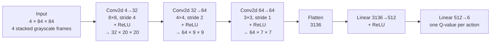
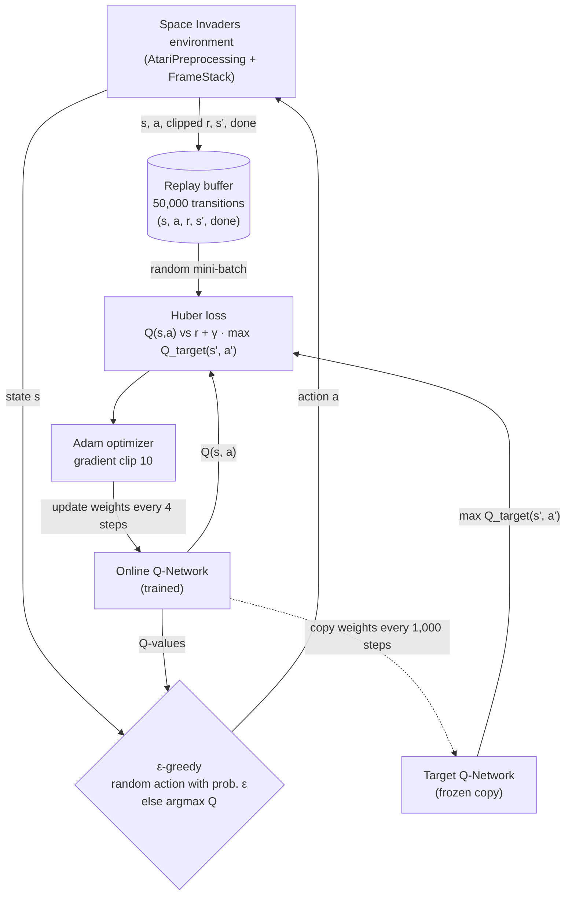
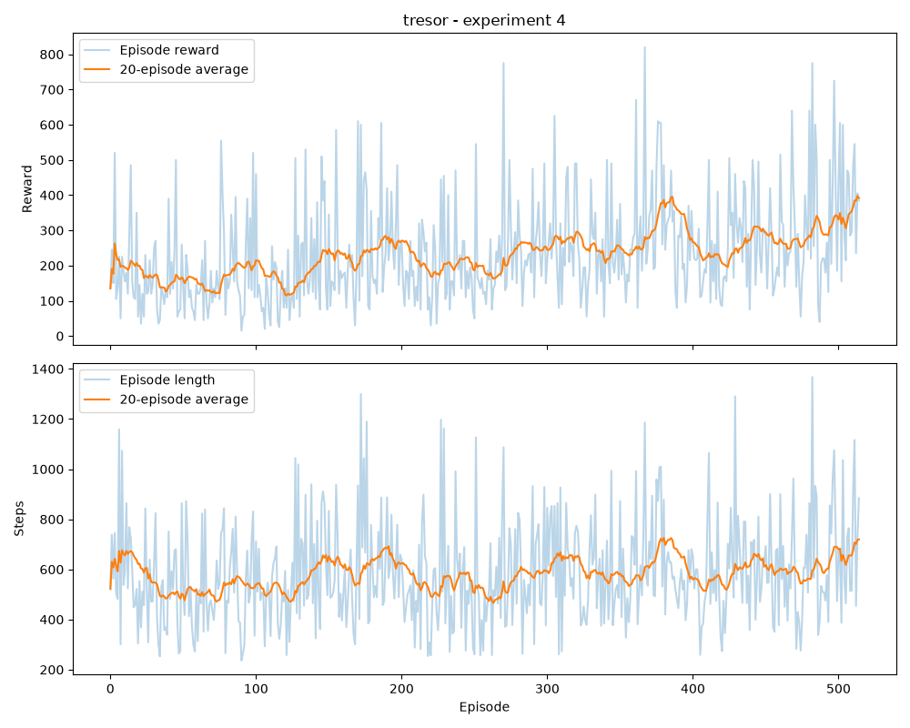

# DQN on Atari Space Invaders

A Deep Q-Network (DQN) agent implemented from scratch with PyTorch and Gymnasium, trained to play Atari Space Invaders. No ready-made RL libraries (Stable-Baselines3, RLlib, etc.) are used.

## Group Members

| Name | Role |
|---|---|
| Nehemie | Environment setup, 10 hyperparameter experiments |
| Tresor | `train.py` and `run_experiments.py`, 10 hyperparameter experiments |
| Sonia | `play.py`, 10 hyperparameter experiments |

**Task allocation sheet:** [Team Task Sheet (Google Sheets)](https://docs.google.com/spreadsheets/d/1FQVPv2dZKu55dp4zg_DISt_vwBcHQVgmiybzSFGW8Ts/edit?usp=sharing): team roles, task tracker and meeting attendance log.


## Selected Environment: Space Invaders

**Environment ID:** `ALE/SpaceInvaders-v5` (Gymnasium + Arcade Learning Environment)

**Objective of the game:** The player controls a laser cannon at the bottom of the screen. Rows of aliens move side to side and slowly descend while dropping bombs. The goal is to shoot as many aliens as possible to earn points, while dodging bombs and hiding behind the shields. The game ends when all lives are lost or the aliens reach the bottom.

**Actions (6):**

| ID | Action |
|---|---|
| 0 | NOOP (do nothing) |
| 1 | FIRE |
| 2 | RIGHT |
| 3 | LEFT |
| 4 | RIGHT + FIRE |
| 5 | LEFT + FIRE |

**Reward:** points for each alien destroyed (aliens in higher rows are worth more; the mystery ship gives bonus points).

### Preprocessing

The raw game frames (210×160 RGB) are prepared with the standard DQN preprocessing (`make_env()` in `train.py`):

| Step | Why |
|---|---|
| Convert to grayscale | Colour is not needed to make decisions; 3× less data |
| Resize to 84×84 | Smaller input → faster network |
| Frame skip = 4 | The chosen action is repeated for 4 frames, speeding up training |
| Stack the last 4 frames | A single frame cannot show movement; 4 frames let the agent see the direction of aliens and bullets |

Final observation given to the network: **4 × 84 × 84** (uint8 pixels).

## Setup

This project uses [uv](https://docs.astral.sh/uv/) for Python and package management.

```bash
uv sync
```

## Training

```bash
uv run train.py --member <YourName> --exp 1 --lr 1e-4 --gamma 0.99 --batch-size 32 \
    --eps-start 1.0 --eps-end 0.05 --eps-decay 100000 --total-steps 300000
```

To run all of a member's experiments from `experiments/<YourName>.json`:

```bash
uv run run_experiments.py --member <YourName>              # all 10
uv run run_experiments.py --member <YourName> --only 1 2   # a subset
```

Outputs are saved to `models/<YourName>/`:
- `exp<N>_dqn_model.pth` – model with the best 20-episode average reward
- `exp<N>_log.csv` – episode, total steps, episode length, reward, epsilon
- `exp<N>_plot.png` – reward and episode-length curves
- `summary.csv` – one row per experiment (hyperparameters, best/final average reward, training time)

## Playing

```bash
uv run play.py                                         # loads dqn_model.pth (best model)
uv run play.py --model models/<YourName>/exp1_dqn_model.pth
```

`dqn_model.pth` at the repo root is the best model of the group: Tresor's experiment 4 (`models/tresor/exp4_dqn_model.pth`). `play.py` always takes the action with the highest Q-value (no random actions).

## DQN Architecture

### Q-Network (CNN)



| Layer | Output shape | Parameters |
|---|---|---|
| Input (÷255 inside `forward`) | 4 × 84 × 84 | 0 |
| Conv2d(4→32, 8×8, stride 4) + ReLU | 32 × 20 × 20 | 8,224 |
| Conv2d(32→64, 4×4, stride 2) + ReLU | 64 × 9 × 9 | 32,832 |
| Conv2d(64→64, 3×3, stride 1) + ReLU | 64 × 7 × 7 | 36,928 |
| Flatten | 3136 | 0 |
| Linear(3136→512) + ReLU | 512 | 1,606,144 |
| Linear(512→6) | 6 | 3,078 |
| **Total** | | **1,687,206** |

This is the CNN from the 2015 DQN Nature paper, built from `torch.nn` layers and trained from random weights (no pretraining). Pixels are stored as `uint8` and divided by 255 inside the network, which keeps the replay buffer 4× smaller.

### Online network, target network and replay buffer

Two copies of the Q-Network above are used. The **online network** chooses actions and is trained every 4 steps. The **target network** is a frozen copy used only to compute the Bellman target, and it receives the online weights every 1,000 steps.



### Training process (`train.py`)

1. **Act:** choose an action with ε-greedy. ε falls linearly from `eps_start` to `eps_end` over `eps_decay` steps.
2. **Store:** save `(obs, action, reward, next_obs, done)` in a 50,000-transition circular replay buffer. Rewards are clipped to −1/0/+1 for training; the real game score is logged.
3. **Learn:** after 10,000 random steps, every 4 steps sample a random mini-batch and compute the Bellman target `r + γ · max_a' Q_target(s', a')` (no future term if the game ended). Minimise the Huber loss with Adam, clipping gradients to norm 10.
4. **Target network:** copy the online network's weights into the target network every 1,000 steps, so the targets stay stable.
5. **Save:** keep the weights with the best 20-episode average reward.

## Hyperparameter Experiments

Each member ran 10 experiments (300,000 steps each, seed 42), changing one hyperparameter at a time from their own baseline.

| Member | Results | Best experiment | Best avg (20 ep) | Final avg (20 ep) |
|---|---|---|---|---|
| Tresor | [TresorHyperparameter_experiment_results.md](TresorHyperparameter_experiment_results.md) | Exp 4: gamma 0.95 | **397.5** | **391.8** |
| Sonia | [SoniaHyperparameter_experiment_results.md](SoniaHyperparameter_experiment_results.md) | Exp 6: batch size 96 | 370.0 | 311.8 |
| Nehemie | [NehemieHyperparameter_experiment_results.md](NehemieHyperparameter_experiment_results.md) | Exp 8: epsilon end 0.2 | 361.5 | 326.5 |

**Group findings:**
- Very small batches (8, 16, 24) gave the weakest runs for all three members.
- Lowering gamma to 0.95 gave the best result overall, but gamma 0.9 (Nehemie) and 0.98 (Sonia) did not, so this needs more seeds to confirm.
- More exploration (higher final ε or slower decay) helped Nehemie's runs; very high final ε (0.15) lowered Sonia's final average.
- Each configuration ran once, so differences under about 20 points are within noise.

## Training Performance of the Best Experiment

**Tresor, experiment 4:** lr 0.0001, gamma 0.95, batch size 32, ε from 1.0 to 0.05 over 100,000 steps. Full per-episode log: [`models/tresor/exp4_log.csv`](models/tresor/exp4_log.csv).



| Metric | Value |
|---|---|
| Total environment steps | 300,000 |
| Episodes completed | 515 |
| Mean episode length | 582.3 steps (shortest 236, longest 1,367) |
| Mean reward over all episodes | 235.5 |
| Highest single-episode reward | 820 (episode 368) |
| Best 20-episode average reward | **397.5** |
| Final 20-episode average reward | **391.8** |
| Training time | 79.9 min (laptop CPU) |

Progress across training (each quarter is about 128 episodes):

| Quarter | Episodes | Steps reached | ε at end | Avg reward | Avg episode length |
|---|---|---|---|---|---|
| 1 | 1–128 | 68,288 | 0.35 | 165.7 | 533.5 |
| 2 | 129–256 | 142,948 | 0.05 | 220.8 | 583.3 |
| 3 | 257–384 | 220,364 | 0.05 | 268.2 | 604.8 |
| 4 | 385–515 | 299,891 | 0.05 | 286.0 | 607.1 |

Average reward rose in every quarter, and episodes got longer as the agent learned to survive. The best 20-episode average came in the final episodes, so the agent was still improving when training stopped.

**Greedy evaluation with `play.py`** (no random actions): 310, 605 and 480 over 3 episodes, an average of **465**. This is higher than the training average because ε-greedy still takes 5% random actions during training.

## Gameplay Demonstration

Best trained agent (Tresor, experiment 4, loaded from `dqn_model.pth`) playing Space Invaders with `play.py`. The agent picks the action with the highest Q-value at every step (no random actions).

**Video:** [`media/gameplay_demo.mp4`](media/gameplay_demo.mp4) (click, then "View raw" to download and play it).

To reproduce the demo:

```bash
uv run play.py
```
